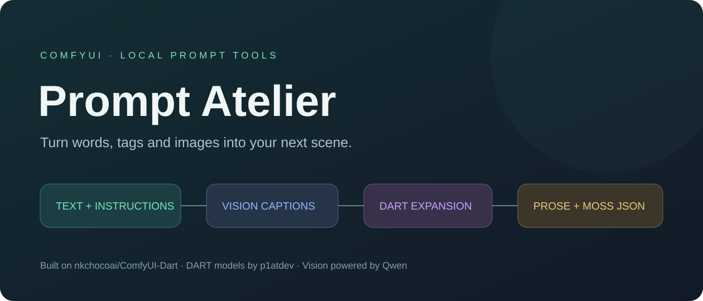

<p align="center"></p>

# ComfyUI Prompt Atelier

**Build image prompts from words, DART tags, or a reference image.** Use a local vision model to caption a photo, change character descriptions with your own instructions, develop tag lists into concepts, and output prose or native MOSS layout JSON.

An expanded fork of [nkchocoai/ComfyUI-Dart](https://github.com/nkchocoai/ComfyUI-Dart), using [p1atdev's DART models](https://huggingface.co/p1atdev) and installed Qwen language/vision models. [Full creator and model credits →](CREDITS.md)

[Quickstart](QUICKSTART.md) · [Workflow gallery](workflows/next/README.md) · [Publishing status](PUBLISHING.md) · [License](LICENSE)

## What you can build

| Start with | Make | Tools |
| --- | --- | --- |
| A sentence | Tags, natural-language prompts, or a new scene concept | Text Assistant + custom instructions |
| A few keywords | Expanded visual tags, then a photographic concept | DART Composer → Generate → Text Assistant |
| A photo | A detailed caption, optionally with a character trigger and requested appearance changes | Image to Text |
| A photo or description | Native MOSS layout JSON with text/object placement | Image to Text → Text Assistant |
| A description | DART v1/v2/v3 expansion with retained tags and sampling controls | Text Assistant → matching DART Composer → Generate |

All 15 nodes include hover help and role-colored guides. Assistants show their result directly. Execution animations respect reduced motion; node designs can be toggled from the context menu.

## Install

This is a **replacement fork** of ComfyUI-Dart. Disable or remove the original installation before installing Prompt Atelier: legacy node IDs are retained so existing workflows load, and the two packs must not register them together. Keep a backup of your workflows.

```bash
cd ComfyUI/custom_nodes
git clone https://github.com/Renz1998/ComfyUI-Prompt-Atelier.git prompt-atelier
# Use the Python environment that runs your ComfyUI:
python -m pip install -r prompt-atelier/requirements.txt
```

Restart ComfyUI. Find nodes under **Prompt Atelier / Assistants**, **Vision**, and **DART**. The assistant names are **Prompt Atelier · Text Assistant** and **Prompt Atelier · Image to Text**; DART-specific tools keep their DART names. Existing workflow class IDs and socket positions are unchanged. An existing installed folder can stay named ComfyUI-Dart; folder names are not used for imports.

**Manager/Registry:** listing is not live yet. The metadata and manual publication workflow are prepared; publisher @renz1998 is configured, and the publishing key still needs to be connected. See [PUBLISHING.md](PUBLISHING.md). Manual Git installation works independently of Registry approval.

## Try a workflow

1. Start with [keywords to concept](workflows/next/keywords_to_concept.json) if an instruction-capable Qwen model is installed.
2. Try [image to text](workflows/next/image_to_text.json), uploading your own image with Load Image.
3. Combine tools with [photo to MOSS layout](workflows/next/photo_to_moss_layout.json) or [description to DART v3](workflows/next/description_to_dart_v3.json).

[Browse every example and its model requirements →](workflows/next/README.md)

The examples produce text and conditioning inputs for your existing image workflow. They do not bundle diffusion checkpoints or automatically generate/save pictures. Local assistance needs recent ComfyUI native Generate Text support and a full generation-capable Qwen checkpoint in text_encoders; photo captioning also needs its vision weights. No assistant weights are downloaded automatically. The optional Chat server backend sends text to the endpoint you configure.

## Model support and limits

- DART v1-sft and v2-sft use their matching composers; v3 Preview E uses the experimental V3 composer. V2-MoE is available but has not had a real-model smoke test here.
- Local text/vision assistance was tested with a full Qwen3-VL 4B checkpoint. Other checkpoints depend on native ComfyUI support and their capabilities.
- MOSS JSON uses the [official experimental layout format](https://github.com/OpenMOSS/MOSS-Image/blob/main/USERGUIDE.md). Match canvas dimensions to your image generation dimensions. Valid boxes do not guarantee exact image placement.
- Character replacement instructions edit the caption, not image pixels. Their interpretation is model-guided. Character triggers do not load LoRAs.

## Credits and development

Original ComfyUI node foundation: **nkchocoai and contributors**. DART models: **p1atdev**. Language/vision models: **Qwen team** and checkpoint conversion authors. MOSS model/layout format: **OpenMOSS team**. Native runtime/frontend: **ComfyUI contributors**. See [CREDITS.md](CREDITS.md).

The original GPL-3.0 source license and upstream history are retained. No model weights are bundled or claimed as our own. Each model retains its own license and access terms.

See [CONTRIBUTING.md](CONTRIBUTING.md) for tests and useful bug reports. If the pack helps your workflow, a GitHub star helps other users find it; reproducible bug reports and example improvements are welcome too.
