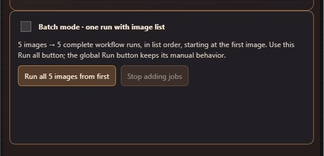

# Prompt Mage — run an image list

Use **Upload Images**. No separate node is needed.

1. Drop your images onto the node or use its file/folder picker.
2. Connect its image output to your complete workflow. For Archmage captions, also connect filename to source_name.
3. Choose **Batch mode**, then click **Run all images from first** on this node.

| Batch mode | With five uploaded images |
| --- | --- |
| **Off — default** | Queue five complete workflow runs: first image through the whole graph, then second, and so on |
| **On** | Queue one complete workflow with a five-image native list; normal downstream list mapping determines the outputs |

Both modes begin at the first visible image and follow the displayed order. The Run all button ignores the manual upload index, wrap setting, max-images limit and global Batch Count. Connected Prompt Mage captioners receive image index 0, including through intermediate processing nodes; unrelated caption branches retain their own indices. The existing editor and its image list are not rewritten.

The runner captures the whole executable graph, settings and seeds once at the start. A fresh run ID prevents an identical repeat from simply returning cached downstream outputs. It does not independently randomize sampler seeds. Change your seed before starting if you want another variation. Each press submits one pass through the list, not the global Batch Count number of passes.

## What the queue does

Separate jobs are appended in order to ComfyUI's native queue. ComfyUI executes complete prompts sequentially; this is not parallel GPU generation. Existing queued work stays ahead of this batch. Once all jobs are confirmed queued, they remain on the server if this browser tab closes.

Keep the tab open until queuing finishes. **Stop adding jobs** prevents further submissions after the current request finishes. It does not cancel jobs already accepted or touch unrelated work. Use the native queue to manage submitted jobs. Queued does not mean successfully generated; model/runtime errors still appear in the native execution UI.

If a request fails, the runner stops without retrying automatically. Check the native queue before starting again: a network failure can leave the last job accepted even if its acknowledgement was lost. Restarting Run all begins again from the first image; it does not resume an interrupted submission.

## List mode and older controls

Batch mode on uses ComfyUI lists, not a single equal-size tensor batch. Differently sized images remain separate. Ordinary image-consuming and Save Image nodes usually produce one result per source image; nodes that combine, aggregate or expand lists can change the output count. List mode holds decoded images in CPU memory. Prefer Batch mode off for large image collections.

The global **Run** button retains its previous manual behavior; use the node's **Run all** button for this automatic whole-list behavior. Right-click Upload Images → **Show advanced manual image controls** to reveal the older selection mode, Index and limit controls. Saved workflows keep their existing behavior when run normally. The Batch mode switch is saved in this node's properties and controls only its Run all button.

The runner belongs to one selected Upload Images node. Other uploaded collections and workflow branches keep their captured settings; this is not a zip/cross-product scheduler for multiple collections. The collection limit is 512 images.

After updating this pack, restart ComfyUI and refresh the browser once. A clear upgrade message appears if the frontend is newer than the backend.
