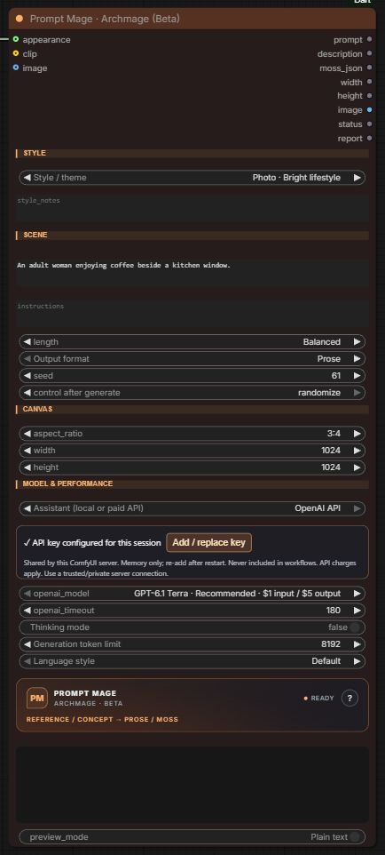
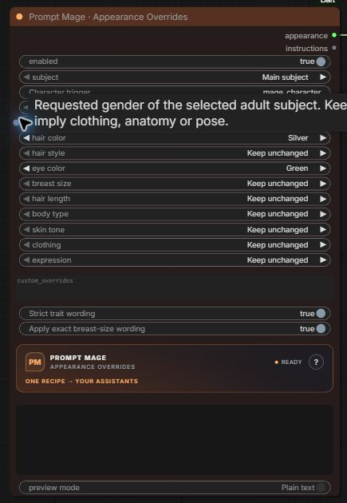
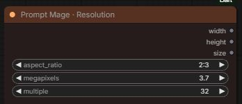
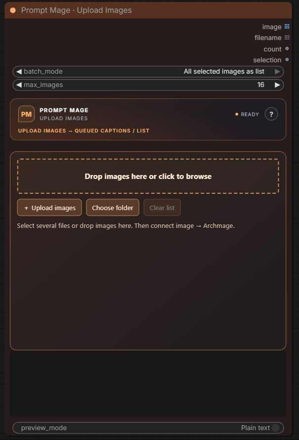

# The current Prompt Mage nodes

Real ComfyUI screenshots from a neutral demo, updated for 1.10.0. Settings shown are examples, not a quality benchmark or a claim that API requests are free.

## Archmage: write a scene or describe a photo

Connect an optional image or appearance recipe, write a scene idea, then choose prose or MOSS JSON. Style comes first; scene, canvas and model controls have separate sections. Local Qwen and OpenAI API backends share the same output sockets.

**Scene idea** supplies WHAT to depict. **Writing rules** controls HOW to describe it. The OpenAI example shows Terra and a configured, collapsed key panel; no credential is visible. [API setup](OPENAI_API.md).

## Appearance Overrides: one reusable character recipe

Choose gender, an exact character trigger, hair/eye colors and the traits you want to replace. Keep unchanged makes no request; Custom reveals your own value. Connect **appearance → Archmage.appearance**. This changes the text description, not source image pixels or loaded character LoRAs.

## Resolution: choose size once

Select aspect ratio, total megapixels and alignment. Connect **width/height** to both Archmage and the empty latent so the prompt's canvas matches the actual image size. Custom dimensions are available from the aspect dropdown. This node allocates no latent or model weights.

## Upload Images: drag, choose files, or choose a folder

Uploads local photos to the ComfyUI server, including RunPod. Batch off runs the complete connected workflow once per image; batch on submits one workflow with the full image list. Both start at the first uploaded image using **Run all images from first**.

[Three starting workflows](../workflows/start-here/README.md) · [Archmage controls](ARCHMAGE_USABILITY.md) · [Return to README](../README.md)
